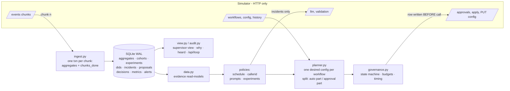

# Outcome-First Agent Loop — Submission

**Name:** Kuzhandayan K V · **Date:** 2026-11-08 · **Hours actually spent (be honest):** about 8 hours (Sat 7 Nov 19:45 – Sun 8 Nov 03:30 IST), building with an AI coding assistant as the brief allows ·
**Language / storage:** Python 3.10+ (only the packages already in `requirements.txt`) / SQLite (WAL), one file

> How to run, debug and extend: [`README_CONTROLLER.md`](README_CONTROLLER.md). Requirement-by-requirement
> status: [`TODO.md`](TODO.md). Reports: [`reports/`](reports/).

---

## 0. TL;DR

1. One process: exactly-once ingest → call-time cohorts + caller-ID health from history → welcome × voice experiments (harm stop, Holm-gated promotion, decay rollback) → hallucination rollback (validated, approved) → one batched request per workflow per day; auto-apply only within policy.
2. **public_01:** +15.2% conclusion rate (+10.6% pickup, +2.9% engagement), 3 harmful of 33 changes; mean over 3 more seeds +16.5%.
3. **public_02:** +28.7% conclusions; bad prompt rolled back 5h after it shipped (hallucinated calls 406 → 188); 0 conflicts, 0 lapses; seeds mean +27.0%.
4. **public_03:** +24.7%, 1 harmful of 100; ≤ 49 s wall per sim day (target 10 min), 145–160k events/s; crash test 9 restarts PASS, 9/9 edge cases PASS, reproducible runs.
5. **Not built, on purpose:** per-person call time (≈5 dials of history per person), prompt A/B tests, cross-tenant credit/attention allocation (C15).

## 1. Assumptions

1. **Guardrail maximum drops are absolute rate differences** against the pre-controller baseline. For
   example, `pickup_rate_max_drop: 0.02` means pickup may fall at most 2 percentage points versus history. This
   is the stricter of the two readings for rates near 0.3–0.6.
2. **The business default config is the experiment control.** It is the config live when the controller first
   sees a workflow.
3. **Welcome message and voice are heard after the call connects,** so they can move engagement but not
   pickup. Caller ID and call time move pickup.
4. **A supervisor edit is deliberate.** We leave the edited dims exactly as set for 24h. After that we change
   them only through an approval request that says so in its first words, and never by auto-apply.
   Hallucination incidents are the one exception: a validated rollback is requested immediately, and it is
   still an approval.
5. **The validation pass rate measures safety only.** The policy minimum (0.97) is necessary but not
   sufficient: we also require +0.005 margin, and we prefer prompts with a live safety record on this workflow.
6. **Auto-apply `max_shift` limits one change, and we respect its intent.** We never chain several PUTs in one
   step to move further, and auto steps are at least 3 sim-hours apart.
7. **A client's own preference that is stricter than the signed policy is honoured.** For example, Kestrel's
   "not before 11:00, two a day" (`settings.TENANT_PREFS`). A looser claim (for example "auto-apply
   everything") is not: the API's policy wins.
8. **Hidden scenarios share the schema.** Lead features, option names and policy fields can differ. Nothing in
   the controller names a workflow, option or feature value, apart from the Kestrel preference above.
9. **At the start the simulator is at D0 00:00 with history available.** If the controller starts later, it
   ingests everything first. A new simulator run needs a new DB file. The DB cannot detect a different world.
10. **"Named human approval" (Northwind)** is the approval ID and decision time the API gives us. The approver's
    name lives in the client's system, not in the simulator.

## 2. Scope decisions

| # | Capability | Built / Partial / Cut | Why | What it would take to finish |
|---|---|---|---|---|
| C1 | Event ingestion at load scale | **Built** | Everything depends on it; exactly-once via one SQLite txn per chunk; 145–160k ev/s | Process-pool parsing / partitioned stream at 10x |
| C2 | One shared cohort object | **Built** | Product memo; same `cohort_id` in config, experiments, detection, view (`cohorts` table) | — |
| C3 | Bootstrapping from history | **Built** | Call-time cells, caller-ID status, hallucination and engagement baselines come from history before D0 | — |
| C4 | Call-time optimisation | **Partial** | Per-cohort hour weights (cells learned from history). Per-person cut (data too thin, §5) | Per-person only for people with ≥8 dials; needs months of history |
| C5 | Caller-ID health | **Built** | Probe unknown numbers at 5%, halve/pull degraded ones, rest + backoff re-probe | Model load explicitly; per-cohort caller IDs |
| C6 | Welcome × voice experiments | **Built** | The engagement lever; factorial by design (independent randomisation) | Explicit interaction test (W×V) |
| C7 | Promotion, decay, rollback | **Built** | Grader and CTO weight it; winners do decay | Faster decay test (CUSUM) |
| C8 | Hallucination incident response | **Built** | Regulated clients; fixed in 5h on public_02 | Pause-a-cohort lever if the business allowed it |
| C9 | Governance client | **Built** | Floor requirement; batching, approver hours, TTL, apply window, stale/expired re-plan, auto-apply | Per-approver fatigue model across workflows |
| C10 | Honest impact, affected leads, dry runs | **Built** | Product: the queue is ranked by impact | Back-test the impact score against realised lift |
| C11 | Consolidated supervisor view | **Partial** | One live page per tenant (+ JSON): what's tested, what's winning, what we want from you, what changed, caller IDs, incidents; refreshes every 10 s and follows the run in progress. Read-only: no actions from the page | Approve/reject buttons wired to the client's system; weekly digest email |
| C12 | Queryable audit store | **Built** | Floor requirement; `why` and `heard` from our own store | — |
| C13 | Crash recovery, demonstrated | **Built** | SRE non-negotiable; `scripts/crash_test.py` | — |
| C14 | Observability of the loop | **Partial** | `metrics` + `alerts` tables, `/api/loop`, page vs ticket | Prometheus exporter / dashboards |
| C15 | Fair allocation across tenants | **Cut** | Credits barely used (5 of 200 on public_02) and approver budgets are per workflow; nothing to arbitrate yet | A per-tenant budget allocator in front of credit spend and request slots |

**The principle:** build what the hidden-scenario grade and the non-negotiables depend on first, and do it
properly: ingestion, governance, incidents, experiments with honest statistics, crash safety and audit. Then
add the cheapest big lever (call time per cohort). Cut what the data can't support (per-person timing) and
what has no conflict to resolve yet (C15). Each cut is written down with the reason and the cost to finish.

## 3. Stakeholders

### 01 — Nikhil Rao, VP Sales

- **Accepted.** A lift number per client: the conclusion rate (leads concluded ÷ uploaded) per workflow
  against the no-op baseline, shown next to pickup and engagement. Speed where it is safe: Kestrel
  welcome/voice moves are auto-applied within its policy.
- **Pushed back.**
  - No single blended score. Product and the README forbid blending pickup and engagement. The conclusion rate
    is the defined business outcome, not a blend.
  - No "winning by lunch, live for everyone by evening". A winner needs ≥300 connected calls per arm and Holm
    tests; promoting on half a day's noise is how false winners and harmful changes happen.
  - The persuasive prompt is not rolled out anywhere. A prompt change needs validation evidence and an approval
    on every workflow, and its catalogue description ("freer objection handling, richer benefit
    explanations") is exactly the hallucination risk compliance is worried about. We only change prompts to
    fix incidents.
- **Wrong against the policy.**
  - "Kestrel has auto-apply for everything." The policy allows `schedule, caller_id, welcome_message, voice`
    with `max_shift 0.2`. Prompt and cohort changes still need approval, and each auto change can move at most
    20% of traffic.
  - "Northwind is fine with auto-apply on KYC." `nw_kyc` has auto-apply **disabled**, and Northwind's
    compliance head requires named approval for anything customer-facing.
- **Reply:**
  > Nikhil, you'll get a lift figure per client: conclusion rate vs the no-op baseline, with pickup and
  > engagement shown beside it, never blended. On public_02 that's +29%. Two things I can't do. First, winners
  > go live once they're statistically real (usually 1–2 days), not by evening; faster promotion is how we'd
  > ship a "winner" that hurts a cohort. Second, Kestrel's auto-apply covers timing, caller ID, welcome and
  > voice, 20% of traffic per step, not prompts; Northwind KYC has no auto-apply at all. The persuasive prompt
  > stays off: prompts only change to fix incidents, with validation evidence.

### 02 — Meera Iyer, Head of Compliance, Northwind Life

- **Accepted.**
  - Welcome, voice and prompt changes on Northwind always go through an approval request; auto-apply is used
    only where the signed policy allows it.
  - Prompt changes carry a validation run ID and must clear 0.97 + 0.005 margin.
  - "Why did this customer hear X": `python -m controller heard --person <id>` answers in seconds, down to
    variant, cohort, config version and the request that made it live.
  - "Slow and right": arms that hurt are suspended once significantly worse; first exploration keeps 50% on
    the business default (70% on KYC).
  - Routine requests are sent only in her approvers' hours (10–19, KYC 10–18), not in the last hour.
- **Pushed back.**
  - Exploration does, briefly, expose some customers to a variant that turns out worse. That is how we learn.
    We bound it, and the harm stop fires after about 150 connected calls on the arm.
  - Incident fixes are sent immediately, even at night. The approver still decides in working hours, but a
    request queued overnight is decided at 10:00 sharp instead of 10:00 + latency.
- **Wrong against the policy.** "Call timing and caller-ID rotation are covered by the policy we signed" is
  true for **renewal** (auto-apply: schedule, caller_id) but **not for KYC**, where auto-apply is disabled. On
  KYC even timing and caller-ID changes go to the approver.
- **Reply:**
  > Meera, every customer-facing change on Northwind goes to your approvers with a summary, diff, affected
  > leads, dry run and, for scripts, a validation run ID. Auto-apply is used only for renewal call timing and
  > caller ID, as signed; on KYC your policy has no auto-apply, so even those come to you. For IRDAI questions
  > we can answer "what did customer X hear on day Y and why" in seconds from our own records. Routine requests
  > arrive only in your approvers' hours. One exception: a hallucination fix is sent as soon as it's validated,
  > even at night, so it's first in the queue at 10:00.

### 03 — Kabir Menon, Platform & SRE

- **Accepted.**
  - Kill/restart is shown, not promised: `scripts/crash_test.py` uses injected hard exits after every kind of
    POST/PUT and mid-ingest, plus random SIGKILLs. 9 starts; nothing lost, nothing applied twice
    ([`reports/crash_recovery.md`](reports/crash_recovery.md)).
  - Idempotency: `proposal_id` is the simulator's idempotency key, and the row is written before the call.
  - Every alert says what to look at; page vs ticket is listed in the runbook.
  - Loop health without logs: `/api/loop` and the `metrics` table.
  - One simulated day of public_03 in 22–49 s on 2 vCPU, with the 10x analysis in §8.
- **Pushed back.** SQLite is a file, not a server, so there is nothing new to operate at 2 a.m. In production
  the same schema goes into the existing Postgres.
- **Wrong against the contract.** Nothing material. "The clock doesn't wait" is true in production; here the
  simulator waits, so we measure wall time per sim day instead.
- **Reply:**
  > Kabir, the crash test is in the repo. It kills the controller after each kind of API write and mid-ingest,
  > plus random SIGKILLs, then checks exactly-once ingest, no double-apply and no lost approvals. It passes on
  > 9 restarts. State is one SQLite file (no server); in production the same tables go into our Postgres, so
  > nothing new to run at 2 a.m. public_03 does a sim day in under 50 s on 2 vCPU (target 10 min). At 10x the first
  > thing to break is the per-call audit table, then the single writer. Loop health is at /api/loop, and pages
  > are only for things that need a human now.

### 04 — Anita Desai, Operations Supervisor, Kestrel Finance

- **Accepted.**
  - Her prompt (and any dim she edits) is left exactly as she set it for 24h, and after that it is changed only
    through an approval request that starts with "CHANGES A SUPERVISOR EDIT". It is never auto-applied.
  - At most 2 routine requests a day, never before 11:00 (`TENANT_PREFS`). Changes are batched into one
    request.
  - One screen: `/tenant/kestrel_finance` shows what's tested, what's winning, what we want from her, what
    changed today, caller IDs and her edits we're respecting.
  - The "verbatim script" trap: an incident fix prefers a prompt with a live record on her workflow (so we know
    its engagement), and after any fix we check engagement and raise a ticket if it fell.
- **Pushed back.**
  - In public_02 her prompt edit (P2) tripled the hallucination-flag rate. We asked her approver to roll it
    back 3.5h after it went live. That is not "behind her back", but it does undo her change.
  - "Tell me before anything changes on a running campaign": policy-permitted auto-applies (timing, caller ID,
    welcome/voice ≤20% per step) appear in her view as they happen, not before. Advance notice would need a
    notification channel we don't have.
- **Wrong against the policy.** "Two requests a day max, never before 11:00": the policy is 4 per 24h from
  10:00. We follow her stricter version anyway, and incidents are exempt.
- **Reply:**
  > Anita, your edits stay exactly as you set them; we never auto-change anything you touched, and if we ever
  > want to, it comes to you as a request that starts "CHANGES A SUPERVISOR EDIT". You'll get at most two
  > routine requests a day, none before 11:00, each one bundling everything. Your one screen shows tests,
  > winners, what we need from you and today's changes. One honest note: if a prompt starts hallucinating, even
  > yours, we'll ask your approver to roll it back within hours, with the evidence attached. Small timing,
  > caller-ID and voice moves your policy allows show up on your screen as they happen.

### 05 — Tara Kulkarni, Head of Product

- **Accepted.**
  - Separate KPIs everywhere.
  - One cohort object (`cohorts` table; the same ID in config, experiments, detection and view).
  - Proposals always carry an impact score, diff, affected-lead count and dry run, and the impact score has a
    stated meaning (§6).
  - An expired request counts as a rejection and is re-planned from fresh data, never resubmitted.
  - Evidence is only what was served: learning reads the variant on each call event, so an arm that never ran
    has no data.
  - Winners change only that workflow's config.
- **Minimum cohort size and window (her open question):**
  - Cells for call time: ≥1,200 history dials.
  - Variant segments: ≥400 connected calls and ≥4% of traffic, Bonferroni across every segment tested, and the
    effect must replicate on odd and even days.
  - Promotion: ≥300 connected calls on the winner, P(best) ≥ 0.95 and Holm.
  - Evidence half-life: 1.5 days.
  - Cost: a 10% relative lift on a 50%-share arm takes about 1–2 days at nw_renewal's volume; smaller segments
    take longer or are never found. That is the price of the false-winner control (§5).
- **Pushed back.**
  - Per-person call time is not built. In history a person has a mean of **5.05 dials and 1.36 connects over
    14 days** (nw_renewal, 9,656 people), against 12 possible hours. A per-person "best hour" would be noise
    presented as personalisation. Call time is learned per cohort instead.
  - Of her three P0s, two are built (supervisor view, caller-ID health) and one is built at cohort level.
- **Wrong.** Nothing against the policy. "All three are P0" is a prioritisation call, not a fact.
- **Reply:**
  > Tara, held to all of it: separate KPIs, one cohort object, every proposal with impact, diff, affected leads
  > and dry run; expired means re-plan on fresh data; evidence is only what was served. Minimums: 300 connected
  > calls before a winner, segments need 400 calls plus Bonferroni plus replication. Cost: segments under ~5%
  > of traffic are rarely found. Per-person call time I didn't build: people have ~5 dials and ~1.4 connects of
  > history across 12 hours, which is noise. Cohort-level timing gave +9–24% pickup. Supervisor view and
  > caller-ID health are built.

### 06 — Aryamann, CTO

- **Accepted.**
  - Explainable over clever: every change has a plain-language reason in the audit store.
  - Harm-first: arms that hurt are suspended; every guardrail stayed within its limit on public_01/02/03.
  - "Best compute is no compute": 5 credits used on public_02 (one validation). The rollback target is a prompt
    with a live safety record, so no LLM call was needed.
  - Scale numbers and the first thing to break at 10x are in §8.
  - Choices and cuts are in §2, the runbook in `README_CONTROLLER.md`.
- **Wrong claims I found** (summary):
  - Sales on Kestrel and KYC auto-apply.
  - Compliance on KYC timing and caller ID.
  - Anita's request limit, which is stricter than the policy, so we follow hers.
- **Reply:**
  > Aryamann, I chose five things to do properly: exactly-once ingest, governance, incident response,
  > experiments with honest statistics, and crash safety with an audit trail. Call time is per cohort. I said
  > no to per-person timing, prompt A/B tests and cross-tenant allocation, with reasons and costs in §2. Three
  > memo claims were wrong against the policies (Kestrel "auto-apply everything", Northwind KYC auto-apply,
  > KYC timing "covered by policy"); the controller follows the API's policy. Results, the 10x analysis and
  > known weaknesses are in the doc.

## 4. Architecture



**State lives only in SQLite.** In memory there are two caches, both rebuilt from SQLite on start: the
person → feature-code array, and the last-seen config per workflow.

**Each step:** ingest pending chunks → refresh configs → poll approvals and apply approved ones → for each
workflow run incident, caller ID, then routine planning → write metrics → `POST /sim/advance 30`.

**On restart:**

1. Re-read every chunk without a `chunks_done` row. A half-processed chunk rolled back with its transaction.
2. Reconcile proposals with status `submitting`/`applying` against `GET /approvals` and the config history by
   `proposal_id`/`approval_id`:
   - if the simulator has it, adopt its state;
   - if it never arrived, mark it `abandoned` and let the planner decide again on fresh data.
3. Continue the loop. Decisions are recomputed from state, so re-running a step at the same sim minute is
   harmless: an in-flight approval blocks new routine requests, and an applied auto change makes the target
   equal to live.

## 5. The learning loop

**Cohorts.**
- *Call-time cells* come from history. For each lead feature we compute a chi-square excess of hour-profile
  differences (z > 3 means real) and cross the two strongest features. A cell needs ≥1,200 history dials, and
  there are at most 12 cells. On the public scenarios only `age_band` clears the bar (z = 17–30; every other
  feature is under 1.5), giving 4 cells.
- *Variant segments* are discovered only from experiment data: singles and pairs of feature values with ≥400
  connected calls and ≥4% share. A segment is created when its best arm differs from the default population's
  preferred arm at Bonferroni α = 0.05/m (m = every (segment, dim) tested that review), **and** the same
  direction holds separately on odd and even days (z > 1.64 on each).
- At most 6 segments. A segment owns only the dim it was created for, so traffic is not fragmented: everyone
  else stays in one large default experiment. The config order is segments first, then call-time cells; cells
  carry no allocation of their own.

**Experiment design.**
- Welcome and voice are randomised independently per call, so one experiment is a full factorial: each dim's
  arms are compared averaged over the other dim at no extra traffic cost. Interactions are assumed absent
  (multiplicative effects); there is no explicit interaction test (§13).
- Evidence per arm is **post-stratified**. Strata are (day × config version × config cohort), weighted by
  stratum size and discounted with a 1.5-day half-life. A unit test shows pooled counts picking the wrong arm
  where this does not.
- First exploration keeps 50% on the business default (70% on pickup-primary workflows) and splits the rest
  equally. Afterwards the allocation follows P(best) with a 10% floor per live arm, damped halfway from the
  live split, and moves only if TV ≥ 0.15 or something happened.
- **Harm stop:** an arm significantly worse than the best (one-sided z, α = 0.01/(k−1), n ≥ 150) is suspended
  at 0%.

**Deciding a winner.** P(best) comes from Beta posteriors via seeded Monte Carlo (20k draws, seed = hash of
workflow, cohort, dim, day), so the result is deterministic and replayable. Promotion requires all three:

- P(best) ≥ 0.95;
- n ≥ 300 connected calls on the winner;
- Holm-corrected one-sided z-tests versus every other live arm at family-wise α = 0.05.

The LLM never takes part. The winner gets 1 − floors, and each other live arm keeps 5% (15% total) as a
contemporaneous reference. False-winner rate: by construction, ≤5% per promotion decision against a null of
"no difference with the strongest rival". Reviews repeat, so the effective rate is higher. Discounting and the
decay test catch a false winner within 1–2 days.

**Decay and rollback.**
- The winner's last-day engagement is compared with its rate **after** promotion. That baseline is unbiased by
  the selection that promoted it; until it exists we use the promotion estimate shrunk halfway to the
  references.
- Rollback needs p < 0.01, a relative drop ≥ 6% beyond any drop in the reference arms, and no open prompt
  incident (an incident moves every arm). Rollback also fires if P(best) falls below 0.5.
- On rollback, suspended arms are revived, evidence before the day before rollback is dropped, and the decayed
  arm is capped at 20% until it earns promotion again.
- public_02: the decaying welcome variant was on 95% of in-population calls at onset and 21% three days later.

**Call time and caller ID.**
- Call time: hour weights per cell are w = clip((p_c(h)/(L_c·p_all(h)))^γ, 0.25, 4), shrunk with 60
  pseudo-dials. They prefer people in the hours that are relatively good *for them*. Each cell's overall
  pickup level L_c is divided out, so no cohort is called more overall, and weights are never 0, so capacity
  is never left unused.
- Per-person timing was rejected (5 dials and 1.4 connects of history per person).
- Caller ID: a number's pickup is compared with the pooled pickup of the other numbers over the same window
  (3h/6h/24h). That comparison is fair because caller ID is drawn independently per dial.
  - Unknown numbers get a 5% probe until 250 dials. They pass if the lower 95% bound of the ratio is ≥ 0.85.
  - A ratio below 0.80 (with z < −3) pulls the number if at least 2 good numbers remain; otherwise its share is
    halved. Below 0.65 it is pulled regardless.
  - A pulled number rests 48h, then 96h, then 192h, and is re-probed at 3%.
  - Healthy numbers share traffic equally, which is the least load per number.

**Guardrail KPI.**
- *Pickup guardrail* (engagement-primary workflows): after a schedule change, whole days of pickup are compared
  with the 7 days before. A drop over 1pp at z > 2.58 removes the hour weights and blocks them for 3 days.
- *Engagement guardrail* (pickup-primary workflows): better timing reaches people sooner, so more connects come
  from people who would only have been reached on a later attempt, and the engagement **rate** falls even as
  conclusions rise. We saw −0.025 on nw_kyc in an early run. Past 75% of the allowed drop, the hour weights
  are softened (γ halved, at most once a day). Welcome/voice experiments also run on these workflows to win
  engagement back.

## 6. Governance

```
approval:  submitting ──► pending ──► approved ──► applying ──► applied
               │             │            │            └──► stale (409) ─► re-plan on fresh data
               │             │            ├──► stale   (config moved before we applied: not even attempted)
               │             │            └──► lapsed  (apply window missed) ─► re-plan
               │             └──► rejected | expired ─► re-plan on fresh data after 2h (never resubmit)
               └──► failed (refused at submit) | abandoned (crash before it reached the simulator)
auto:      submitting ──► applied | refused (403) | stale | failed | abandoned
```

- **Batching and timing.**
  - One routine request per workflow per day, carrying everything: cohorts, allocations, call time, caller ID.
    A second one is allowed after ≥6h only if something happened (promotion, rollback, new segment, harm stop).
  - Routine requests are sent only between approver start (or the tenant's later preference) and one hour
    before approver end. One request per 24h is always kept free for incidents.
  - Each request expires at the policy TTL. Approved requests are applied within one 30-minute step, well
    inside the 2h window: 0 lapses in every run.
  - Incident requests go out immediately at any hour.
- **Auto-apply.**
  - Used only for dims in `allowed_dims`, only when no approval is in flight (so it never makes a pending
    request stale), at most every 3 sim-hours, and at most `max_shift` TV per change. No chaining.
  - Never used on a dim a supervisor edited.
  - We voluntarily keep cohort changes and anything that reverts a supervisor edit on the approval path, even
    where the policy would allow them.
- **Impact, affected leads, dry run.**
  - *Impact* is the projected relative change in the workflow's primary KPI, workflow-wide, where +10% = 1.0,
    clipped to [0.01, 1]. For experiments it is the cohort's share of connected calls × the expected change
    from measured arm rates. For call time it is **half** the dry-run pickup gain (the dry run ignores
    eligibility depletion, so it is an upper bound). Incidents score 0.6 plus severity, so they top the queue.
    Exploration proposals honestly score near 0: their value is information.
  - *Affected leads* counts leads in running campaigns that have not concluded and whose served distribution,
    hour weight or prompt changes. It is an upper bound, because leads whose attempts are used up for the day
    still count.
  - *Dry run* replays measured per-arm engagement and per-cohort hourly pickup (last 10–21 days) against the
    proposed allocation.
- **Supervisor edits mid-experiment.**
  - The `config_changed` event with `actor: supervisor` freezes the edited dims for 24h and marks them sticky.
  - Any pending approval is not applied once the version moves. It becomes `stale` and is re-planned with the
    supervisor's values kept.
  - Learning is unaffected, because it uses the variant each call actually got.
  - public_02 shows both cases: the nw_renewal voice edit on D5 was left alone; the ks_cancel prompt edit on
    D3 was rolled back by approval because it was unsafe.

## 7. Incidents

- **Detection thresholds.**
  - The flag rate on the live prompt must exceed max(2× baseline, baseline + 1.2pp) with an exact one-sided
    binomial p < 1e-4, on ≥200 connected calls.
  - Two windows are tested: the last 4h, and everything since the prompt last changed (a known change point,
    up to 24h back).
  - The baseline is the history flag rate (1.3–1.5%), which already includes the detector's false positives.
  - Expected false-positive rate: roughly 3e-4 per look, about 48 looks a day, so about 1 spurious incident per
    70 workflow-days. A spurious incident costs one validation (5 credits) and a request the approver would
    reject.
- **Picking a fix.**
  1. A prompt this workflow already ran safely: ≥800 connected calls, flag rate ≤ 1.3× baseline, and the
     Wilson upper bound ≤ 2× baseline. Prefer the one live just before.
  2. Only if there is none: LLM suggestions (3 credits), validating the top two.
  - Every candidate is validated at n = 500 (5 credits) and must clear the policy minimum + 0.005.
- **Credit spend.** 5 credits on public_02. Routine work never spends below a 20-credit reserve.
- **Verification.** After apply, we wait for ≥300 connected calls on the new prompt. The flag rate must be
  ≤ 1.5× baseline, or not significantly above baseline. We also compare engagement with the 3 days before the
  incident and raise a ticket if it dropped (the "verbatim script" case).

**Timeline from public_02** (from the `decisions` table):

| sim time | what happened |
|---|---|
| D1 18:00 | ks_cancel: caller ID D2 pulled: pickup 22.9% vs 29.2% on the other numbers over 6h (1,022 dials, z = −3.5). The scenario spam-flags D2 at D2 10:00, so it was already at 0% of calls on D2; later re-probes kept it at ≤3% |
| D3 11:30 | ks_cancel: the supervisor ships prompt P2; the controller freezes `prompt_version` |
| D3 15:00 | incident opened: 4.8% flags on 374 connected calls vs 1.5% baseline (p = 1.5e-5). P1 validated: pass rate 0.986 on n = 500 (5 credits). Request sent: "CHANGES A SUPERVISOR EDIT — Roll back prompt P2 → P1", impact 0.93 |
| D3 15:53 | approved by the client approver (apr_00009) |
| D3 16:30 | applied as v12 (first step after the decision became visible). **Time to fix: 300 minutes** from the bad edit |
| D3 20:00 | verified: 0.6% flags on 313 connected calls on P1 |
| D5 15:00 | nw_renewal: the supervisor edits voice. Left exactly as set for 24h; later changes go only through requests that say so |

## 8. Scale

Measured on public_03_load on **2 vCPU / 8 GB**, with the simulator on the same box. Wall times include
simulation. Full details are in [`reports/public_03_load.md`](reports/public_03_load.md).

| metric | value |
|---|---|
| ingest throughput | 145k–160k events/s (single thread, stdlib json) |
| history at start-up | 5.54M events in 34.9 s ingest / 48.9 s wall |
| wall-clock per simulated day | **22–49 s** (target: under 10 min) |
| decision lag per 30-min step, all 12 workflows | p50 0.46 s · p95 1.51 s · p99 1.79 s · max 2.0 s |
| peak RSS | 748 MB (during the history load) |
| SQLite after 5 days | 379 MB |
| outcome | +24.7% conclusions, 1 harmful of 100 changes, 0 conflicts, 0 lapses |

**What breaks first at 10x:**

1. The per-call "what they heard" table: about 20M rows per 5 days. Move it to the warehouse or day-partitioned
   Postgres, or turn it off with `STORE_CALLS=0`.
2. The single SQLite writer and single process: one slow workflow delays all.
3. Single-threaded JSON parsing: about 57 s of CPU per 10x day, still fine but on the critical path.
4. Planner re-reads of 10 days of aggregates per workflow.

**Partitioning:** shard by `workflow_id`. Every decision is per workflow. Workers own hash ranges, consume an
event stream keyed by workflow, and keep state in Postgres with an advisory lock per workflow. Credits and
approver attention are the only cross-workflow resources; they go to a small allocator (C15).

## 9. Reliability

- **Crash-recovery test:** `python scripts/crash_test.py --kills 4`
  ([`reports/crash_recovery.md`](reports/crash_recovery.md)) on public_02, 9 controller starts on one DB file.
  - Injected hard exits (`os._exit`, like kill -9) right after an approval POST, after an apply POST, after an
    auto-apply PUT, and inside an ingest transaction. Then 4 random SIGKILLs.
  - All checks pass:
    - the scenario finished;
    - every simulator approval is in our store, with the same state;
    - no approval applied twice;
    - 0 apply conflicts, 0 lapses;
    - every applied controller version is `applied` in our store;
    - ingested events equal emitted events (324,382);
    - connected-call aggregates equal a recount of the raw chunks.
  - The crashed run still scored +25.3% conclusions.
- **Edge cases, end to end** (`scripts/edge_cases.py`, [`reports/edge_cases.md`](reports/edge_cases.md),
  9/9 pass), each one against a real simulator:
  - controller started before the simulator;
  - simulator unreachable (clear error, no hang);
  - start mid-scenario;
  - start after the scenario finished;
  - restart on a finished DB;
  - a DB from a different simulator run (refused);
  - a second controller on the same DB (refused);
  - a hallucination incident with only 2 credits (pages, never overspends, finishes);
  - the simulator restarted under the controller (refused, no mixing of worlds).
- **From scratch:** before submitting, everything above was re-run from a fresh clone with a clean environment
  and a `--no-cache` Docker build: tests, both scenarios, audit queries, the view, the crash test, the edge cases,
  `docker compose up`, `run.sh` in Docker, and a container kill/restart. All passed, with the same grades as the
  plain-Python runs.
- **Reproducible runs:** the controller pins `PYTHONHASHSEED=0` (it re-execs itself if needed), and every
  Monte Carlo draw is seeded. Two independent runs of the same scenario give identical grades. You can replay
  any decision.
- **State lost on a crash:** nothing durable. A step's planning work is recomputed from state. A request that
  never reached the simulator is marked `abandoned` and re-decided on fresh data, so a stale decision is never
  replayed.
- **Idempotency keys:**
  - `proposal_id = {workflow}.{purpose}.m{sim_minute}.{n}`, written before the POST/PUT.
  - Chunks are keyed by chunk number in `chunks_done`.
  - `calls_heard` by `event_id`, `world_events` by `event_id`.
- **4xx/5xx handling.**
  - GETs and idempotent POSTs/PUTs retry with backoff on 5xx and transport errors.
  - `/sim/advance` is never blindly retried: on a timeout we read `/sim/state` to see whether time moved.
  - Credit-spending calls are never retried automatically.
  - `409 duplicate_proposal_id` → reconcile. `409 stale_base_version` → `stale`, re-plan. `410` → `lapsed`,
    re-plan. `403` → `refused`, logged. `402` → alert; the incident stays open.
  - One workflow's planner exception is logged and paged; the others continue.

## 10. Audit & observability

The CTO's question, answered from our store on the public_02 run:

```
$ python -m controller why --db state/public_02.db --workflow ks_cancel --at "D3 16:30"
# ks_cancel — config v12 applied D3 16:30 (asked about D3 16:30)
**Who:** client approver via approval apr_00009
**Changed:** prompt_version
**Request:** ks_cancel.incident.m5220.1 (incident, via approval), submitted D3 15:00, decided D3 15:53
**Summary:** CHANGES A SUPERVISOR EDIT (prompt_version) -- Roll back prompt P2 -> P1: hallucination flags at 4.8% vs 1.5% normal
**Why:** This request changes prompt_version, which a supervisor edited; we left it untouched for 24h and are asking
  rather than changing it ourselves. | Since P2 went live, 18 of 374 connected calls were flagged for hallucination
  (4.8%; normal is 1.5%; p=1.5e-05). P1 ran on 20285 connected calls here with a 1.5% flag rate and 50.5% engagement;
  validation val_00001 passed.
**Impact score:** 0.927  ·  **Affected leads:** 3475
**Lifecycle:**
- D3 15:00 proposal.submit / proposal.pending apr_00009
- D3 16:30 proposal.approved: apr_00009 approved at 2027-01-07T15:53, apply by 17:53
- D3 16:30 proposal.applied: applied as config v12 (dims ['prompt_version'])
**Evidence in the 24h before:**
- D3 11:30 supervisor.edit: supervisor changed prompt_version (v10) ...
- D3 15:00 incident.opened: hallucination flags 4.8% on P2 over 374 connected calls vs baseline 1.5% (p=1.5e-05)
- D3 15:00 incident.validation: validated P1: pass rate 0.986 on n=500 (meets our bar 0.975)
**KPIs 24h before:** pickup 0.2579, engagement 0.4823, hallucination flags 0.0314
**KPIs 24h after:**  pickup 0.2469, engagement 0.4962, hallucination flags 0.0151
**Next change:** v13 at D3 18:00 by controller_auto (caller_id)
**What happened next (48h):**
- D3 20:00 incident.verified: fix verified: flags 0.6% on 313 connected calls with P1 (baseline 1.5%)
```

(The full output also prints the diff and the dry run. `--json` gives the same as JSON. `heard --person <id>`
answers the IRDAI "what did this customer hear and why" question.)

**Page on:**
- a hallucination spike (a fix is being requested);
- no validated fix available;
- hallucinations still high after a fix;
- credits exhausted during an incident;
- an approved change lapsed;
- a planner exception.

**Ticket, don't page:**
- credits low with no incident;
- a rejection that cites evidence (a bug on our side);
- engagement lower after a prompt fix.

**Neither:**
- a judgement-call rejection;
- an expired request;
- a supervisor edit;
- a caller ID pulled or re-probed.

These are handled automatically and shown in the view. Loop health: `GET /api/loop` gives ingest events and
events/s, decision lag p50/max, decisions in the last sim hour, credits used, peak RSS, pending approvals and
the latest pages.

## 11. Results

**public_01** ([`reports/public_01.md`](reports/public_01.md)):

| workflow | conclusion rate | Δ | pickup | Δ | engagement | Δ | engagement gap captured | hallucinated calls (base) |
|---|---|---|---|---|---|---|---|---|
| ks_cancel | 0.387 | +13.4% | 0.263 | +9.6% | 0.512 | +2.4% | 21% | 67 (52) |
| nw_kyc | 0.470 | +24.8% | 0.284 | +17.2% | 0.638 | +4.2% | 38% | 22 (21) |
| nw_renewal | 0.469 | +11.6% | 0.284 | +8.5% | 0.560 | +2.3% | 28% | 50 (39) |
| ALL | 0.432 | +15.2% | 0.274 | +10.6% | 0.554 | +2.9% | 27% | 139 (112) |

33 changes: 17 beneficial, 13 neutral, 3 harmful. Governance: 15 requests, all approved and applied,
18 auto-applies, 0 refused, 0 conflicts, 0 lapses, peak 2 requests per 24h. Credits used: 0.

**public_02** ([`reports/public_02.md`](reports/public_02.md)):

| workflow | conclusion rate | Δ | pickup | Δ | engagement | Δ | engagement gap captured | hallucinated calls (base) |
|---|---|---|---|---|---|---|---|---|
| ks_cancel | 0.376 | +54.1% | 0.255 | +39.9% | 0.501 | +6.1% | 44% | 82 (310) |
| nw_kyc | 0.463 | +20.6% | 0.294 | +18.9% | 0.597 | −0.4% | −1% | 44 (38) |
| nw_renewal | 0.490 | +13.8% | 0.295 | +12.0% | 0.554 | +1.1% | 4% | 62 (58) |
| ALL | 0.432 | +28.7% | 0.277 | +24.0% | 0.540 | +1.8% | 26% | 188 (406) |

35 changes: 10 beneficial, 21 neutral, 4 harmful. Governance: 22 requests (20 approved, 2 judgement-call
rejections, 0 expired), 19 applied by approval, 16 auto-applies, 0 conflicts, 0 lapses, peak 2 per 24h.
Prompt incident time to fix: 300 minutes. Credits used: 5.

**Robustness across seeds** (`scripts/eval_seeds.py`: the same scenarios with only the random seed changed, 3
seeds each, full table in [`reports/seed_robustness.md`](reports/seed_robustness.md)):

| scenario | conclusion Δ (mean) | pickup Δ | engagement Δ | gap captured | harmful / changes | incident fix |
|---|---|---|---|---|---|---|
| public_01 (3 seeds) | +16.5% (range +14.7 … +18.7) | +9.2% | +5.2% | 33% | 1.3 / 37 | — |
| public_02 (3 seeds) | +27.0% (range +24.5 … +29.0) | +21.6% | +2.5% | 26% | 2.3 / 41 | 330–450 min |

Every one of the 6 runs improved conclusion rate, pickup and engagement.

**Interpretation.**

*Where we helped:*
- **Pickup, on every workflow,** from call-time cohorts and from spreading dials across healthy numbers. Fresh
  numbers carry less load than the two the business had used for weeks.
- **ks_cancel on public_02 most of all:** the flagged number was pulled on D2 and the bad prompt rolled back on
  D3.
- **Engagement-primary workflows gained engagement** from promoted variants. On public_01 the decaying welcome
  variant was rolled back about two days after its effect started to fade.

*Where we were harmful, and why:* 3–4 changes per scenario, all of them **exploration moves**.
- On public_01: three Kestrel welcome/voice steps, auto-applied within `max_shift`.
- On public_02: the first KYC exploration and three renewal welcome/voice moves.
- Each moved 10–25% of a cohort's traffic onto an arm that later proved worse, which the grader judges
  harmful at apply time. That is the price of learning, bounded by the 50% (70% on KYC) control share and the
  harm stop.
- An earlier version also had harmful caller-ID re-probes of a really spam-flagged number. Rest with
  exponential backoff and a 3% re-probe share removed them.
- On **nw_kyc in public_02,** engagement fell 0.4% relative (inside the 0.02 guardrail), and the
  engagement-gap figure is about zero. On a `next_campaign_only` workflow, an exploration allocation stays
  live on each campaign for its 3 cadence days even after we revert it, so exploration costs more there.

*What I'd change:*
- Explore pickup-primary, campaign-locked workflows less, or not at all.
- Add an explicit welcome × voice interaction check.
- Back-test the impact score against realised lift.

## 12. Trade-offs & rejected alternatives

| Option | Why considered | Why rejected / what instead |
|---|---|---|
| Pure Thompson sampling, re-allocated every step | Fastest learning | Every allocation move costs an approval or a config version; noise flip-flopped allocations and made approvers see churn. Instead: P(best) with damping, a TV ≥ 0.15 threshold and one request a day |
| Pooled counts per arm | Simple | Simpson's paradox when allocations change over time or differ by cohort. Instead: post-stratified by day × version × cohort (unit test included) |
| Permanently dropping losing arms | Less exposure to bad arms | A decayed winner could never be replaced. Instead: suspend, and revive on rollback |
| Per-person preferred hour (`lead_preferred_hour`) | Product's headline | 5 dials / 1.4 connects of history per person across 12 hours; a 6x/0.25x weight on noise could hurt. Instead: per-cohort weights learned from history |
| Pulling every slow caller ID | Simple rule | Concentrating load on fewer numbers degrades them too (we saw 97% on one number). Instead: graded halve/pull, ≥2 numbers kept, rest + backoff |
| Ask the LLM first in an incident | It's provided | Costs credits; suggestions can be worse ("verbatim", "persuasive"). Instead: a known-good prompt from our own records first; LLM only if there is none |
| Pause dialling (all hour weights 0) during an incident | Stops harm immediately | The business owns whether and when to call; this is capacity in disguise. Rejected |
| Prompt A/B tests | Prompts may hold the biggest engagement lever | One prompt per workflow; time-switchback tests are confounded by decay and incidents, and every switch needs approval and validation. Cut |
| Postgres / Redis now | SRE already runs them | Network services to run in the grader's box. Instead: SQLite now, the same schema in Postgres in production |
| Chaining auto-apply PUTs to get past `max_shift` | Faster on Kestrel | Against the intent of the policy. Instead: one step per 3 sim-hours |

## 13. Known weaknesses

1. **Interaction between welcome and voice is assumed away.** Effects are treated as multiplicative and
   separable. A strong W×V interaction would be missed.
2. **Repeated looks.** Promotion tests run at every review, so the real false-winner rate is above the nominal
   5%. Discounting and the decay test catch false winners after the fact, not before.
3. **Small segments are rarely found.** The Bonferroni + replication bar means a segment under ~5% of traffic
   with a 10–20% effect usually stays undetected (for example, a voice that only works for over-60s in one
   language).
4. **Seed variance is real.** Across seeds, nw_renewal on public_01 ranges +8.4% to +14.6%, and the incident
   time to fix ranges 300–450 minutes. Approval rejections, approver latency and early random draws matter a
   lot over 8–10 days. Runs are reproducible for a given seed.
5. **The affected-lead count is an upper bound,** and the call-time dry run ignores eligibility depletion. Its
   impact is halved as a heuristic, not a measured correction.
6. **`next_campaign_only` workflows:** allocation and caller-ID fixes only reach new campaigns. A bad caller ID
   keeps dialling old campaigns for up to their cadence length. We don't reprioritise those leads.
7. **Hallucination detection depends on an imperfect flag.** If the detector's false-positive rate shifted, the
   history baseline would be wrong. No separate safety signal is used.
8. **No per-approver fatigue across workflows.** The same human approving several Northwind workflows sees the
   sum of our requests.
9. **The Docker build needs network access to Docker Hub and PyPI.** It was verified both with the real
   `python:3.12-slim` image (`docker compose up` on macOS: build, healthy simulator, controller ran D0–D7 and
   exited 0) and offline with a local base image (`BASE_IMAGE=...`). There's no pinned image digest or lock
   file, so a future `python:3.12-slim` or package release could change behaviour. Pin both before production.
10. **The supervisor view is read-only.** Approving still happens in the client's system.

## 14. If this went to production at Formi next month

1. **Shadow mode first (week 1).** Run the loop read-only on 3–5 real workflows. Compare its proposals and
   "would-have" decisions with what happened, especially false incident alarms and caller-ID pulls.
2. **Move state to Postgres** and put the event ingest on the real stream, keyed by workflow, with the same
   exactly-once commit (offset + aggregates in one transaction). Re-run the crash test against it.
3. **Back-test the impact score and the dry runs** against realised lift on shadow data, so the supervisor
   queue ranking means what it says.
4. **Wire the approval surface into the client tools:** named approver, approve/reject from the one-screen
   view, and a weekly digest of auto-applied changes for Northwind compliance.
5. **Go live on one tenant with auto-apply limited to caller ID.** Widen as alerts prove actionable. Add
   per-approver fatigue and the cross-tenant credit/attention allocator (C15) before the tenth tenant.
